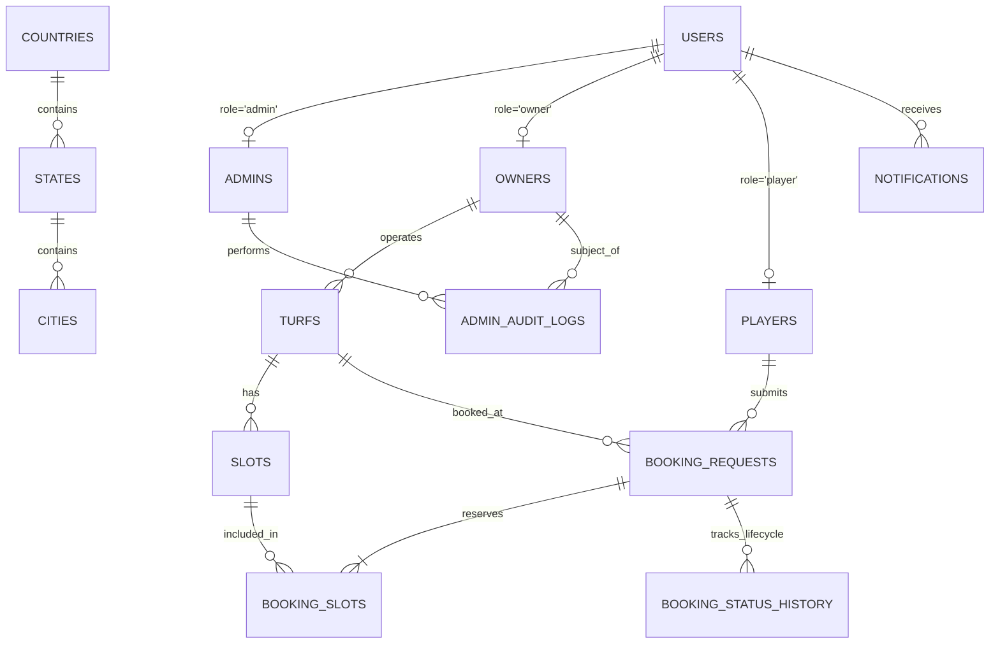

# TurfSync – Database Architecture & Direct SQL Design

## 1. Architectural Philosophy: Strictly NO ORM

As specified in the architectural constraints of TurfSync, **no Object-Relational Mapping (ORM) is used**.
- **No Django Models** for application entities.
- **No `Model.objects.*`** calls.
- **No ORM migrations** or serializers.
- All database interactions use direct, parameterized SQL executed via `psycopg` (v3) through a high-performance connection pool with dictionary row factories (`dict_row`).

### Advantages Realized
1. **Explicit Query Execution**: Every transaction, lock, and join is deliberate and transparent.
2. **ACID Concurrency Controls**:
   - `SELECT ... FOR UPDATE` row-level locks on slots during booking approval to eliminate race conditions.
   - Atomic transactions (`with get_db_connection() as conn: with conn.transaction(): ...`) ensuring multi-table writes either fully commit or cleanly rollback.
3. **Database-Enforced Integrity**:
   - `CHECK` constraints on user roles, slot durations (30, 60, 90 mins), operating hours (`closing_time > opening_time`), and positive player capacities.
   - `UNIQUE` compound constraints (`unique_turf_per_owner_city`, `unique_slot_per_turf_time`).
   - `ON DELETE RESTRICT` on turfs and slots preventing accidental cascade deletion when active bookings exist.

---

## 2. Entity Relationship Overview



---

## 3. Core Database Tables & Schemas

### `users`
Central identity repository with PBKDF2-hashed passwords and role constraints.
- `id`: BIGSERIAL PRIMARY KEY
- `email`: VARCHAR(255) UNIQUE NOT NULL
- `password_hash`: VARCHAR(255) NOT NULL
- `role`: VARCHAR(20) NOT NULL CHECK (role IN ('admin', 'owner', 'player'))
- `status`: VARCHAR(30) NOT NULL DEFAULT 'Active' CHECK (status IN ('Pending Approval', 'Approved', 'Rejected', 'Suspended', 'Active', 'Inactive'))
- `created_at`: TIMESTAMPTZ DEFAULT CURRENT_TIMESTAMP

### `owners`
Business profile for turf owners requiring administrative verification.
- `id`: BIGSERIAL PRIMARY KEY
- `user_id`: BIGINT NOT NULL REFERENCES users(id) ON DELETE CASCADE
- `full_name`: VARCHAR(150) NOT NULL
- `brand_name`: VARCHAR(150) NOT NULL
- `mobile`: VARCHAR(20) NOT NULL
- `gst_number`: VARCHAR(50)
- `bank_account_number`: VARCHAR(50) NOT NULL
- `bank_ifsc`: VARCHAR(20) NOT NULL
- `date_of_birth`: DATE NOT NULL
- `id_proof_type`: VARCHAR(50) NOT NULL
- `id_proof_file`: TEXT NOT NULL
- `business_proof_file`: TEXT NOT NULL
- `owner_type`: VARCHAR(50) NOT NULL
- `sports_offered`: TEXT[] NOT NULL
- `verification_id_proof`: BOOLEAN DEFAULT FALSE
- `verification_ownership_proof`: BOOLEAN DEFAULT FALSE
- `verification_bank_details`: BOOLEAN DEFAULT FALSE
- `account_status`: VARCHAR(30) DEFAULT 'Pending Approval'

### `players`
Player profiles and preferences.
- `id`: BIGSERIAL PRIMARY KEY
- `user_id`: BIGINT NOT NULL REFERENCES users(id) ON DELETE CASCADE
- `full_name`: VARCHAR(150) NOT NULL
- `mobile`: VARCHAR(20) NOT NULL
- `date_of_birth`: DATE NOT NULL
- `favorite_sports`: TEXT[]
- `profile_photo`: TEXT

### `turfs`
Sports arenas operated by approved turf owners.
- `id`: BIGSERIAL PRIMARY KEY
- `owner_id`: BIGINT NOT NULL REFERENCES owners(id) ON DELETE RESTRICT
- `name`: VARCHAR(150) NOT NULL
- `sport`: VARCHAR(50) NOT NULL
- `surface`: VARCHAR(50) NOT NULL
- `size`: VARCHAR(50) NOT NULL
- `city_id`: BIGINT REFERENCES cities(id)
- `weekday_price_per_hour`: NUMERIC(10, 2) NOT NULL
- `weekend_price_per_hour`: NUMERIC(10, 2) NOT NULL
- `max_players`: INT NOT NULL CHECK (max_players > 0)
- `opening_time`: TIME NOT NULL
- `closing_time`: TIME NOT NULL CHECK (closing_time > opening_time)
- `turf_type`: VARCHAR(20) NOT NULL CHECK (turf_type IN ('Indoor', 'Outdoor'))
- `amenities`: TEXT[] DEFAULT '{}'
- `photos`: TEXT[] DEFAULT '{}'
- `status`: VARCHAR(20) DEFAULT 'Active'

### `slots`
Atomic time units available for reservation.
- `id`: BIGSERIAL PRIMARY KEY
- `turf_id`: BIGINT NOT NULL REFERENCES turfs(id) ON DELETE RESTRICT
- `slot_date`: DATE NOT NULL
- `start_time`: TIME NOT NULL
- `end_time`: TIME NOT NULL CHECK (end_time > start_time)
- `duration_minutes`: INT NOT NULL CHECK (duration_minutes IN (30, 60, 90))
- `price_override`: NUMERIC(10, 2)
- `status`: VARCHAR(20) DEFAULT 'Open' CHECK (status IN ('Open', 'Requested', 'Booked', 'Blocked', 'Closed'))
- `block_reason`: TEXT

### `booking_requests`
End-to-end booking records from pending request to approved/completed.
- `id`: BIGSERIAL PRIMARY KEY
- `booking_reference`: VARCHAR(50) UNIQUE NOT NULL
- `player_id`: BIGINT NOT NULL REFERENCES players(id) ON DELETE RESTRICT
- `turf_id`: BIGINT NOT NULL REFERENCES turfs(id) ON DELETE RESTRICT
- `booking_date`: DATE NOT NULL
- `number_of_players`: INT NOT NULL
- `team_name`: VARCHAR(100)
- `payment_preference`: VARCHAR(50) NOT NULL
- `special_requests`: TEXT
- `rules_accepted`: BOOLEAN NOT NULL CHECK (rules_accepted = TRUE)
- `total_amount`: NUMERIC(10, 2) NOT NULL
- `advance_payment_received`: BOOLEAN DEFAULT FALSE
- `status`: VARCHAR(30) DEFAULT 'Pending' CHECK (status IN ('Pending', 'Approved', 'Rejected', 'Expired', 'Cancelled', 'Completed', 'No-Show'))
- `rejection_category`: VARCHAR(100)
- `rejection_reason`: TEXT
- `cancellation_reason`: TEXT
- `owner_note`: TEXT
- `expires_at`: TIMESTAMPTZ

---

## 4. Performance Indexes

Created in `backend/database/indexes.sql`:
```sql
CREATE INDEX idx_users_email ON users(email);
CREATE INDEX idx_turfs_owner ON turfs(owner_id);
CREATE INDEX idx_turfs_city_sport ON turfs(city_id, sport);
CREATE INDEX idx_slots_turf_date ON slots(turf_id, slot_date);
CREATE INDEX idx_slots_status ON slots(status);
CREATE INDEX idx_booking_player ON booking_requests(player_id);
CREATE INDEX idx_booking_turf_date ON booking_requests(turf_id, booking_date);
CREATE INDEX idx_booking_status ON booking_requests(status);
CREATE INDEX idx_notif_user_unread ON notifications(user_id, is_read);
```
