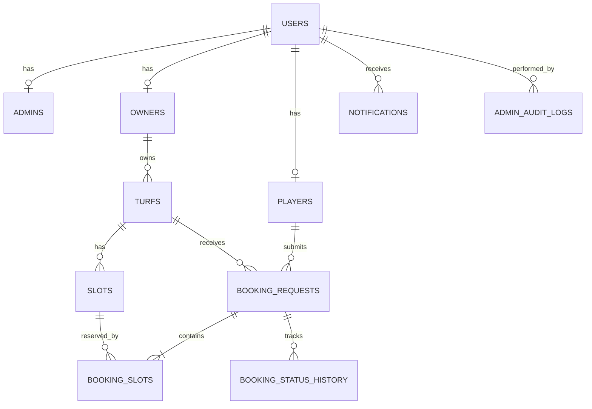

# TurfSync Database Architecture & Specification

## 1. Direct PostgreSQL Architecture (STRICT NO-ORM)
TurfSync strictly forbids Django ORM models and migrations. All database connectivity, transactions, and queries are executed through **psycopg** with parameterized statements, guaranteeing high performance, complete transparency, and defense against SQL injection.

## 2. Table Schemas & Constraints

### 2.1 `users`
- `id SERIAL PRIMARY KEY`
- `email VARCHAR(255) UNIQUE NOT NULL`
- `password_hash VARCHAR(255) NOT NULL` (PBKDF2-HMAC-SHA256, 390,000 iterations)
- `role VARCHAR(20) NOT NULL CHECK (role IN ('admin', 'owner', 'player'))`
- `status VARCHAR(25) NOT NULL CHECK (status IN ('Pending Approval', 'Approved', 'Rejected', 'Suspended', 'Active', 'Inactive'))`
- `created_at TIMESTAMP WITH TIME ZONE DEFAULT CURRENT_TIMESTAMP`
- `updated_at TIMESTAMP WITH TIME ZONE DEFAULT CURRENT_TIMESTAMP`

### 2.2 `admins`
- `id SERIAL PRIMARY KEY`
- `user_id INTEGER UNIQUE NOT NULL REFERENCES users(id) ON DELETE CASCADE`
- `full_name VARCHAR(150) NOT NULL`
- `status VARCHAR(20) NOT NULL CHECK (status IN ('Active', 'Inactive'))`
- *Rule*: Admins cannot be registered from the application; they must be inserted directly in the database. Only an Active database admin can log in.

### 2.3 `owners`
- `id SERIAL PRIMARY KEY`
- `user_id INTEGER UNIQUE NOT NULL REFERENCES users(id) ON DELETE CASCADE`
- `full_name VARCHAR(150) NOT NULL` (Letters and spaces only)
- `brand_name VARCHAR(150) NOT NULL`
- `mobile VARCHAR(15) UNIQUE NOT NULL` (10 digits)
- `gst_number VARCHAR(15)` (Optional, 15 chars)
- `bank_account_number VARCHAR(25) NOT NULL` (9–18 digits)
- `bank_ifsc VARCHAR(15) NOT NULL` (11 chars)
- `country_id, state_id, city_id REFERENCES geography tables`
- `id_proof_type VARCHAR(50) CHECK (id_proof_type IN ('Aadhaar', 'PAN', 'Passport', 'Driving Licence'))`
- `owner_type VARCHAR(50) CHECK (owner_type IN ('Individual', 'Partnership', 'Company'))`
- `sports_offered TEXT[] NOT NULL`
- `date_of_birth DATE NOT NULL` (Age 18+ enforced)
- `id_proof_file, business_proof_file VARCHAR(500) NOT NULL`
- `verification_id_proof BOOLEAN DEFAULT FALSE`
- `verification_ownership_proof BOOLEAN DEFAULT FALSE`
- `verification_bank_details BOOLEAN DEFAULT FALSE`
- `account_status VARCHAR(25) DEFAULT 'Pending Approval'`
- *Rule*: ID proof, ownership proof, and bank details must ALL be verified by an admin before approval is allowed.

### 2.4 `turfs`
- `id SERIAL PRIMARY KEY`
- `owner_id INTEGER REFERENCES owners(id) ON DELETE CASCADE`
- `name VARCHAR(150) NOT NULL`
- `address TEXT NOT NULL`
- `contact_number VARCHAR(15) NOT NULL` (10 digits)
- `sport VARCHAR(50) CHECK (sport IN ('Football', 'Cricket', 'Badminton', 'Basketball', 'Tennis', 'Pickleball'))`
- `surface VARCHAR(50) CHECK (surface IN ('Natural Grass', 'Artificial Turf', 'Wooden', 'Synthetic'))`
- `size VARCHAR(50) CHECK (size IN ('5-a-side', '7-a-side', '9-a-side', 'Full Size'))`
- `weekday_price_per_hour NUMERIC(10, 2) NOT NULL CHECK (weekday_price_per_hour > 0)`
- `weekend_price_per_hour NUMERIC(10, 2) NOT NULL CHECK (weekend_price_per_hour > 0)`
- `max_players INTEGER NOT NULL CHECK (max_players > 0)`
- `advance_booking_limit_days INTEGER NOT NULL DEFAULT 30 CHECK (advance_booking_limit_days BETWEEN 1 AND 90)`
- `opening_time, closing_time TIME NOT NULL CHECK (closing_time > opening_time)`
- `turf_type VARCHAR(20) CHECK (turf_type IN ('Indoor', 'Outdoor'))`
- `amenities TEXT[] NOT NULL`
- `status VARCHAR(20) DEFAULT 'Active' CHECK (status IN ('Active', 'Inactive'))`
- `photos TEXT[] NOT NULL` (1+ photos required)
- *Constraint*: `UNIQUE(owner_id, city_id, name)` (Turf name unique per owner and city)
- *Rule*: Turf deletion is strictly blocked if upcoming approved bookings exist!

### 2.5 `slots`
- `id SERIAL PRIMARY KEY`
- `turf_id INTEGER REFERENCES turfs(id) ON DELETE CASCADE`
- `slot_date DATE NOT NULL`
- `start_time, end_time TIME NOT NULL CHECK (end_time > start_time)`
- `duration_minutes INTEGER CHECK (duration_minutes IN (30, 60, 90))`
- `status VARCHAR(20) DEFAULT 'Open' CHECK (status IN ('Open', 'Requested', 'Booked', 'Blocked', 'Closed'))`
- `block_reason VARCHAR(100)`
- *Constraint*: `UNIQUE(turf_id, slot_date, start_time, end_time)`
- *Rule*: Overlapping slots on the same turf are rejected. Slots must be within operating hours. Slots with approved bookings cannot be blocked or deleted.

### 2.6 `booking_requests`
- `id SERIAL PRIMARY KEY`
- `booking_reference VARCHAR(30) UNIQUE NOT NULL`
- `player_id INTEGER REFERENCES players(id) ON DELETE CASCADE`
- `turf_id INTEGER REFERENCES turfs(id) ON DELETE CASCADE`
- `booking_date DATE NOT NULL`
- `number_of_players INTEGER NOT NULL CHECK (number_of_players > 0)`
- `team_name VARCHAR(50)`
- `add_ons JSONB DEFAULT '[]'::JSONB`
- `payment_preference VARCHAR(50) CHECK (payment_preference IN ('Pay at Turf', 'Pay Online After Approval'))`
- `total_amount NUMERIC(10, 2) NOT NULL CHECK (total_amount >= 0)`
- `status VARCHAR(20) DEFAULT 'Pending' CHECK (status IN ('Pending', 'Approved', 'Rejected', 'Expired', 'Cancelled', 'Completed', 'No-Show'))`
- `expires_at TIMESTAMP WITH TIME ZONE` (12-hour timeout from creation or slot start time)

## 3. Booking Lifecycle State Transitions
1. `Pending` -> `Approved` (Owner approves; locks slot as Booked; auto-rejects other Pending requests for slot).
2. `Pending` -> `Rejected` (Owner rejects with category & reason).
3. `Pending` -> `Cancelled` (Player withdraws at any time).
4. `Pending` -> `Expired` (Auto-expired if not acted on within 12 hours or by slot start time).
5. `Approved` -> `Completed` (Owner marks complete after slot time has passed).
6. `Approved` -> `No-Show` (Owner marks that player did not arrive).
7. `Approved` -> `Cancelled` (Player or owner cancels before slot start time per cancellation policy).
